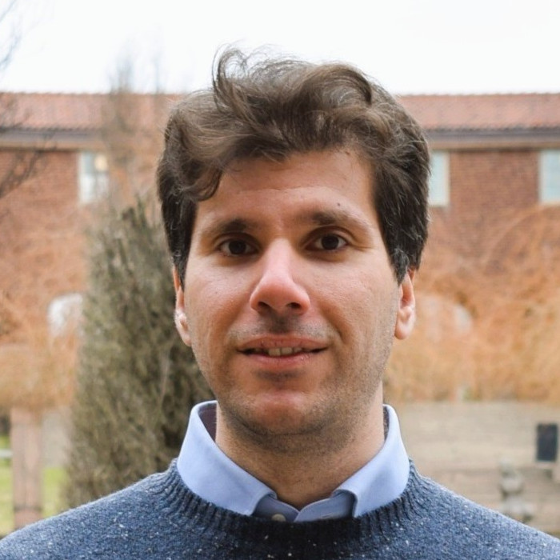

#+TITLE: Can Aknesil's CV
#+AUTHOR: Can Aknesil
#+OPTIONS: toc:nil author:nil date:nil num:nil title:nil

#+HTML_HEAD_EXTRA: <link rel="stylesheet" href="https://cdnjs.cloudflare.com/ajax/libs/font-awesome/6.5.1/css/all.min.css">
#+HTML_HEAD_EXTRA: <link rel="stylesheet" href="https://fonts.googleapis.com/css2?family=Source+Sans+3:ital,wght@0,400;0,700;1,400;1,700&display=swap">
#+HTML_HEAD_EXTRA: 

* Can Aknesil

#+ATTR_HTML: :class wrapright

@@html:<i class="fa-solid fa-envelope"></i>@@
\_ [[mailto:aknesil@kth.se][aknesil@kth.se]]
\_  @@html:<i class="fa-brands fa-github"></i>@@
\_ [[https://github.com/canaknesil][github.com/canaknesil]]
\_  @@html:<i class="fa-brands fa-linkedin"></i>@@
\_ [[https://www.linkedin.com/in/can-aknesil-phd-831507a3/][LinkedIn]]
\_  @@html:<i class="fa-solid fa-globe"></i>@@
\_ [[https://www.canaknesil.com/cv][Extended CV]]

Hardware security researcher (PhD, KTH) working on power/EM and microarchitectural
side-channel attacks, FPGA and GPU security, and LLVM-based countermeasures. Experienced in industry collaboration (Ericsson Research), teaching, and supervising students.

** PROFESSIONAL EXPERIENCE

*Postdoctoral Researcher* /(June 2025 – Present)/\\
[[https://www.kth.se/en][KTH Royal Institute of Technology]], Stockholm\\
School of Electrical Engineering and Computer Science, Department of Network and Systems Engineering
- [[https://eprint.iacr.org/2026/806][Combined attacks with power and microarchitectural side channels]] 
- [[https://ectopass.com/][Detection and mitigation of microarchitectural side channels in LLVM]]
- Side channels on multi-tenant GPUs

*Doctoral Researcher (PhD)* /(March 2021 – June 2025)/\\
[[https://www.kth.se/en][KTH Royal Institute of Technology]], Stockholm\\
School of Electrical Engineering and Computer Science, Department of Electrical Engineering, Division of Electronics and Embedded Systems\\
Industry collaboration with Ericsson Research (hybrid fingerprinting, FPGA EM sensor, covert antennas)
- [[https://github.com/canaknesil/hybrid-fingerprinting-ext][Side-channel fingerprinting of neural networks]] (Ericsson collaboration) 
- Covert [[https://github.com/canaknesil/fpga-em-sensor][EM sensor]] and [[https://github.com/canaknesil/antenna-from-interconnect/][antenna]] implementations on FPGA (Ericsson collaboration)
- [[https://github.com/canaknesil/rpi3-memory-leakage][EM side-channel analysis on general-purpose computers (Raspberry Pi)]]
- [[https://github.com/canaknesil/CircuitDisguise.jl][Malicious-circuit detection in cloud FPGAs without IP disclosure]]
- Side-channel attacks on Xilinx Artix-7 FPGA bitstream encryption engine
- Bitstream extraction from SPI flash communication

*Research Engineer* /(June 2020 – January 2021)/\\
[[https://www.kth.se/en][KTH Royal Institute of Technology]], Stockholm\\
School of Electrical Engineering and Computer Science, Department of Electrical Engineering, Division of Electronics and Embedded Systems
- Deep learning-based power side-channel analysis of AES on FPGA
- Machine learning modeling attacks on Physically Unclonable Functions (PUFs)

*Intern* /(June 2019 – November 2019)/\\
[[https://www.ericsson.com/en][Ericsson AB]], Stockholm\\
High Performance Broadband/Radio Software Department
- Robust Header Compression (RoHC) for Profile 6 (TCP/IP)
- Interfacing C++ high-performance radio simulation libraries from Julia

*Intern* /(July 2017 – September 2017)/\\
[[http://www.ctech.com.tr][CTech Bilişim Teknolojileri San. ve Tic. A.Ş.]], Istanbul\\
Hardware Department
- Embedded Linux development for millimeter wave wireless communication

*Intern* /(February 2017 – June 2017)/\\
[[https://it.ku.edu.tr][Koç University]], Istanbul\\
IT Department\\
Communication and Infrastructure Services

*Intern* /(July 2016 – August 2016)/\\
[[http://obss.com.tr][OBSS]], Istanbul\\
Technology Department
- HR job advert & application management web application, in Java

** OTHER PROJECTS

- [[https://github.com/canaknesil/4x4-apuf][FPGA implementation and statistical analysis of Arbiter PUF with 4x4 Switch Blocks]] /(MSc Embedded Systems thesis, under the supervision of Elena Dubrova)/
- Single-Event Upset Detector (SEUD) Experiment in [[https://mistsatellite.space/][the Miniature Student Satellite (MIST)]] /(MSc Embedded Systems final project)/
- [[https://github.com/canaknesil/snowflake-with-cuda][CUDA Compilation Support for Snowflake DSL]] /(Computer Engineering Final Project)/
- [[https://github.com/canaknesil/mam][MAM: A Memory Allocation Manager for GPUs]], in C, compatible with C++ and CUDA [[https://parcorelab.ku.edu.tr/][/(ParCoreLab)/]]
- [[https://github.com/canaknesil/limon][Limon]]: A simple and powerful general-purpose programming language /(Independent)/
- [[https://github.com/canaknesil/fpga-fir-filter-generator][FPGA C++ Framework for FIR Filtering Applications]] /(Electrical & Electronics Engineering Final Project)/
- [[https://github.com/canaknesil/go-game][Go (board game, not the programming language) computer game in Rust]] /(Independent)/
- [[https://github.com/canaknesil/cannons-algorithm-mpi][Cannon’s matrix multiplication algorithm, in C, using MPI library]] /(Independent)/
- Unix-style operating system shell, in C, on Linux /(During undergraduate study)/
- Air traffic control simulator, in C++, using pthread.h library /(During undergraduate study)/
- Cache simulator, in C /(During undergraduate study)/
- Sound Transmission via Amplitude Modulation of Light, electronic circuit and simulation on PSpice /(During undergraduate study)/
- Digital clock, on FPGA board using VHDL /(During undergraduate study)/

** PROFESSIONAL SKILLS

Hardware and computer security\\
- Power/EM side-channel attacks
- Microarchitectural side-channel attacks
- FPGA security
- GPU security
- Machine learning security
- Networking and network security
- Penetration testing
  
Hardware design\\
- FPGA design and verification with VHDL and SystemVerilog
  (using Xilinx Vivado and Intel/Altera Quartus)
- Tcl scripting in the Xilinx Vivado environment
- RTL synthesis with Yosys
- Analysis of digital circuits

Embedded systems design\\
- Embedded real-time platform and software development with Nios II soft-processor and MicroC/OS
- Embedded software development with Linux and baremetal in AVR, MIPS, ARM assembly, C, C++
- Fault-tolerant systems design

High-performance computing (HPC)\\
- Parallel programming with pthread library, MPI, and CUDA

Computer science\\
- C, C++, Rust, Java, Julia, Python, Matlab, Lisp, Haskell, Bash, PowerShell, Tcl
- Git, Subversion, GNU Make, CMake
- Software engineering
- Scientific programming
- Machine learning (supervised and unsupervised)
- Proficiency in Linux (daily use, system administration, driver and application development)
- Compiler and interpreter design with Lex, Yacc, LLVM, and PLY
# - Proficiency in Microsoft Office
# - LaTeX

Other\\
- PCB design using KiCad
- Mixed-signal IC design using Cadence Virtuoso
- Image analysis and computer vision
- Mobile application development for iOS (Objective-C) and Android (Java)
- Web development with HTML, JavaScript, CSS, PHP, Java EE, and Django
- Database design with SQL and MongoDB
- Electronic circuit simulation with PSpice and LTspice
- Emacs Lisp programming
- Amateur radio (SA0NCA)

# TODO: Add lab equipment (oscilloscopes, EM probes, ChipWhisperer, etc.)

** EDUCATION

*Doctoral Study in Information and Communication Technology* /(2021 – 2025)/\\
KTH Royal Institute of Technology, Stockholm\\
School of Electrical Engineering and Computer Science\\
Specialization: Electronic Systems\\
Title: Protecting Remote FPGAs and Embedded Devices from Non-Invasive Physical Attacks\\
Supervisor: Prof. Elena Dubrova

*Master of Science in Embedded Systems (Platform track)* /(2018 – 2020)/\\
KTH Royal Institute of Technology, Stockholm\\
School of Electrical Engineering and Computer Science

*Bachelor of Science in Electrical & Electronics Engineering* /(2013 – 2018)/\\
*Double Major in Computer Engineering*\\
Koç University, Istanbul\\
College of Engineering\\
(25% Scholarship)\\
GPA: 3.44 / 4\\
Vehbi Koç Scholar in 2014 and 2016\\
Member of [[https://parcorelab.ku.edu.tr/][Koç University - Parallel and Multicore Computing Laboratory]]
# September 2016 – March 2018

*High School* /(2008 – 2013)/\\
Notre Dame de Sion French High School, Istanbul 

** PUBLICATIONS

[[https://eprint.iacr.org/2026/806][Can Aknesil, Andreas Lindner, Roberto Guanciale, Hamed Nemati. "Spectre Without Dependent Load". Cryptology ePrint Archive, Paper 2026/806. 2026.]]

[[https://www.diva-portal.org/smash/record.jsf?pid=diva2%3A1958212&dswid=2918][Can Aknesil. "Protecting Remote FPGAs and Embedded Devices from Non-Invasive Physical Attacks". Doctoral Thesis, Royal Institute of Technology (KTH), Stockholm, Sweden. 2025.]]

[[https://eprint.iacr.org/2025/673][Can Aknesil, Elena Dubrova, Niklas Lindskog, Jakob Sternby, Håkan Englund. "Hybrid Fingerprinting for Effective Detection of Cloned Neural Networks". Cryptology ePrint Archive, Paper 2025/673. 2025.]]

[[https://ieeexplore.ieee.org/document/11038304][Can Aknesil, Elena Dubrova, Niklas Lindskog, Jakob Sternby, Håkan Englund. "Hybrid Fingerprinting for Effective Detection of Cloned Neural Networks". 2025 IEEE 55th International Symposium on Multiple-Valued Logic (ISMVL). 2025.]]

[[https://doi.ieeecomputersociety.org/10.1109/DSD64264.2024.00055][Can Aknesil, Elena Dubrova. "Circuit Disguise: Detecting Malicious Circuits in Cloud FPGAs without IP Disclosure". 2024 27th Euromicro Conference on Digital System Design (DSD). 2024.]]

[[https://doi.org/10.1109/TrustCom60117.2023.00259][Can Aknesil, Elena Dubrova, Niklas Lindskog and Håkan Englund. "A Near-Field EM Sensor Implemented in FPGA Configurable Fabric". 2023 IEEE 22nd International Conference on Trust, Security and Privacy in Computing and Communications (TrustCom). 2023.]]

[[https://doi.org/10.1109/IPDPSW59300.2023.00025][Can Aknesil, Elena Dubrova, Niklas Lindskog and Håkan Englund. "Is Your FPGA Transmitting Secrets: Covert Antennas from Interconnect". 2023 IEEE International Parallel and Distributed Processing Symposium Workshops (IPDPSW). 2023.]]

[[https://doi.org/10.1109/VLSI-SoC54400.2022.9939649][Can Aknesil and Elena Dubrova. "Towards Generic Power/EM Side-Channel Attacks: Memory Leakage on General-Purpose Computers". 2022 IFIP/IEEE 30th International Conference on Very Large Scale Integration (VLSI-SoC). 2022.]]

[[https://doi.org/10.1109/ISMVL51352.2021.00035][Can Aknesil and Elena Dubrova. "An FPGA Implementation of 4x4 Arbiter PUF". 2021 IEEE 51st International Symposium on Multiple-Valued Logic (ISMVL). 2021.]]

[[http://www.diva-portal.org/smash/record.jsf?pid=diva2%3A1460662][Can Aknesil. "An FPGA Implementation of Arbiter PUF with 4x4 Switch Blocks". Master's Thesis, Royal Institute of Technology (KTH), Stockholm, Sweden. 2020.]]

[[https://www.canaknesil.com/docs/MAM_A_Memory_Allocation_Manager_for_GPUs.pdf][Can Aknesil and Didem Unat. "MAM: A Memory Allocation Manager for GPUs". 5. Ulusal Yüksek Başarımlı Hesaplama Konferansı, Istanbul, Turkey. September 2017.]]

** TALKS (excluding presentations of my own research at conferences)

*Invited Talk* /(10 June 2026)/\\
[[https://www.uu.se/][Uppsala University]], Uppsala, Sweden\\
Department of Electrical Engineering, Integrated Smart Systems Technology\\
Title: Side Channels with Can

*Guest Lecture* /(29 September 2025)/\\
[[https://www.kth.se/en][KTH Royal Institute of Technology]], Stockholm\\
Title: Physical Attacks & Hardware Trojans\\
Course: EP2780 Digital Forensics and Incident Response

** ACADEMIC SERVICE

USENIX Security Program Committee member /(2027)/

** TEACHING EXPERIENCE

*Course Development*\\
[[https://www.kth.se/en][KTH Royal Institute of Technology]], Stockholm\\
Developed the following lectures, associated laboratory exercises, and quizzes for EP2780 Digital Forensics and Incident Response, to be delivered in Fall 2026:
- Mobile Forensics
- Physical Attacks & Hardware Trojans

*Lecturer* /(Fall 2026)/\\
[[https://www.kth.se/en][KTH Royal Institute of Technology]], Stockholm\\
- EP2780 Digital Forensics and Incident Response /(Fall 2026)/

*Teaching Assistant*\\
[[https://www.kth.se/en][KTH Royal Institute of Technology]], Stockholm\\
- IL1333/FIL3030 Hardware Security /(during doctoral studies)/
- ID2218/FIL3200 Design of Fault-Tolerant Systems /(during doctoral studies)/
- IL2203 Digital Design and Hardware Description Languages /(during doctoral studies)/
- EP2780 Digital Forensics and Incident Response /(during postdoc)/

*Undergraduate Teaching Assistant*\\
[[https://eng.ku.edu.tr/en/][Koç University]], Istanbul\\
- Comp200 Structure and Interpretation of Computer Programs /(Fall 2017)/

*Instructor* /(20 – 30 June 2016)/\\
[[https://www.stanford.edu/][Stanford University]] & [[https://eng.ku.edu.tr/en/][Koç University]], Istanbul\\
[[http://www.csbridge.org][CS Bridge Program]]

** SUPERVISION EXPERIENCE

*Master's Student Supervision* \\
[[https://www.kth.se/en][KTH Royal Institute of Technology]], Stockholm\\
- Federico Mercurio. Enhanced RAN Security Test Planning Through LLM-Driven Test Selection and Structured RAG Workflows. /(Spring 2026)/
- Miguel Valgañón Soria. Reproducible and Relational Method for Detecting Constant-Time Violations in LLVM Optimization Passes. /(Spring 2026)/

*Doctoral Student Supervision* \\
[[https://www.kth.se/en][KTH Royal Institute of Technology]], Stockholm\\
- Siyao Liu /(Spring 2026)/\\
  (In addition to the main and co-supervisors)
  

** PEDAGOGICAL TRAINING

[[https://www.kth.se/en][KTH Royal Institute of Technology]], Stockholm\\
- FLH3000 Basic Communication and Teaching, 3 credits
- LH207V Doctoral Supervision, 3 credits (ongoing)

** LANGUAGE SKILLS

*Turkish:* Native

*English:* Professional
# *English:* IELTS in 2018 (Overall: 6.0, Listening: 6.0, Reading: 6.5, Writing: 5.0, Speaking: 5.5), TOEFL iBT in 2017 (Overall: 88, Listening: 27, Reading: 22, Writing: 22, Speaking: 17)

*Swedish:* Intermediate
# *Swedish:* SFI Course C in 2021 (roughly corresponds to CEFR A2/A2+), KTH Swedish C1 for Employees in 2025

*French:* Intermediate
# *French:* DELF B2 in 2012 (Overall: 57.5/100, Listening: 11/25, Reading: 12.5/25, Writing: 18/25, Speaking: 16/25)

** AWARDS

- Vehbi Koç Scholar 2014, 2016
- International mathematical competition named "Le Kangourou des mathématiques", 22nd among 10627 participants, 2011

** CONFERENCES & WORKSHOPS

- [[http://www.fpgaworld.com/][FPGAworld Conference]] in Stockholm. /(2026)/
- [[https://www.digitalfutures.kth.se/event/challenges-and-opportunities-of-pqc-deployment-workshop/][Challenges and Opportunities of PQC Deployment Workshop]]. /(2026)/
- [[https://mvl.jpn.org/ISMVL2025/][IEEE 55th International Symposium on Multiple-Valued Logic (ISMVL)]]. Presented a research paper. /(2025)/
- [[https://dsd-seaa.com/dsd2024/][27th Euromicro Conference Series on Digital System Design]]. Presented a research paper. /(2024)/
- [[https://cysep.conf.kth.se/][Cybersecurity and Privacy (CySeP) Summer School]]. /(2024)/
- [[https://raw.necst.it/][30th Reconfigurable Architectures Workshop (RAW)]]. Presented a research paper. /(2023)/
- [[https://vlsisoc2022.com/][30th IFIP/IEEE International Conference on Very Large Scale Integration (VLSI-SoC)]]. Presented a research paper. /(2022)/
- [[http://www.fpgaworld.com/][FPGAworld Conference]] in Stockholm. /(2022)/
- [[http://www.mvl.jpn.org/ISMVL2021/][IEEE 51st International Symposium on Multiple-Valued Logic (ISMVL)]]. Presented a research paper. /(2021)/
- [[https://sscs.ieee.org/][Solid-State Circuits Directions Inaugural Workshop: Hardware Security]]. /(2020)/
- [[https://www.tecosa.center.kth.se/][TECoSA Federated Learning Workshop]]. /(2020)/
- [[http://www.fpgaworld.com/][FPGAworld Conference]] in Stockholm. /(2019)/
- [[http://www.fpgaworld.com/][FPGAworld Conference]] in Stockholm. /(2018)/
- [[http://www.basarim.org.tr][National High Performance Computing Conference (BAŞARIM)]] (Ulusal Yüksek Başarımlı Hesaplama Konferansı). Presented a research paper. /(2017)/

- Training named "Neuroscience for Leadership" at Kariyer.Net /(2017)/
- Training named "Idea Production Techniques" at Kariyer.Net /(2017)/
- Training named "Communication Mastery" at Kariyer.Net /(2017)/
- Training named "Personal Quality" at Kariyer.Net /(2017)/
- Training named "Sustainable Motivation" at Kariyer.Net /(2017)/
- Training named "Gamification" at Kariyer.Net /(2017)/

# - Participated in a workshop organized by NDS to "Istanbul Technical University Energy Institute Nuclear Researches Division". Observation of "ITU TRIGA Mark-II Training and Research Reactor". /(2012)/

** HOBBIES & OTHER INTERESTS

- Music: Piano, oud (a classical Turkish instrument), and guitar
  # - London College of Music Piano Examinations, Grade 5
  # - Koç Orchestra, piano and keyboard, during 3 years. Performed 7 concerts
  # - Water Clock (band), keyboard, during 1 year. Performed 2 concert
- Summer sports: Sailing, windsurfing
  # - Have an Amateur Yacht Captain License
  # - Participated to optimist courses at Ataköy Marine
  # - Participated to sailing education at Istanbul Sailing Club
  # - Officially licensed, intermediate level windsurfer registered with the Turkish Sailing Federation.
- Tennis, table tennis, badminton
  # - Table tennis team member in Notre Dame de Sion (high school)
- Winter sports: Skiing, ice skating

